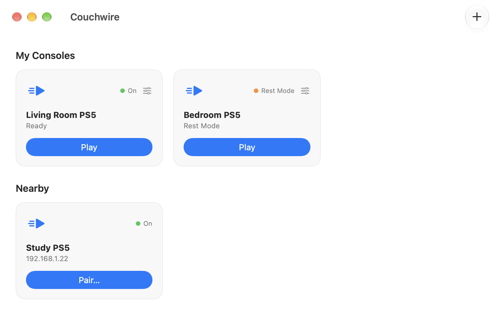

<p align="center">
  
</p>

<h1 align="center">Couchwire</h1>

<p align="center">
  <strong>Play your PS5 on your Mac: a native Remote Play app.</strong>
</p>

<p align="center">
  <picture><source media="(prefers-color-scheme: dark)" srcset="assets/brand/elbeehq-hive-on-dark.svg"></picture>&nbsp;<picture><source media="(prefers-color-scheme: dark)" srcset="assets/brand/elbeehq-wordmark-on-dark.svg"></picture>
</p>

<p align="center">
  <a href="https://github.com/ElBeeHQ/Couchwire/releases/latest"></a>
  <a href="https://github.com/ElBeeHQ/Couchwire/releases/latest"></a>
  <a href="https://github.com/ElBeeHQ/Couchwire/releases/latest"></a>
  <a href="https://github.com/ElBeeHQ/Couchwire/releases"></a>
  <a href="LICENSE"></a>
  <a href="https://elbeehq.com/privacy"></a>
</p>

<p align="center">
  <picture>
    <source media="(prefers-color-scheme: dark)" srcset="assets/screenshot-dark.png">
    
  </picture>
</p>

Couchwire streams your PS5 to your Mac, at home or over the internet. It's built for macOS from the ground up, with full
DualSense support, HDR and low latency.

## Why Couchwire

- **Up to 1080p at 60 fps,** in H.264, HEVC or HEVC with HDR on an HDR display, with the bitrate you choose.
- **Play away from home** over the internet, through your PlayStation Network account. No port forwarding needed.
- **Adjusts to your connection.** Each stream starts at the quality your connection can handle and learns from every
  session, while smoothing evens out frames and sound that arrive unevenly.
- **The DualSense, in full:** rumble, adaptive triggers, haptics over USB, the light bar, the PS button and the mute
  button. DualShock 4, Xbox and other controllers and the keyboard work too.
- **Voice chat** through your Mac's microphone, switched on and off with the DualSense's mute button.
- **Wakes your PS5** from rest mode when you press Play, and puts it back to rest when you're done. Start from the
  menu bar without opening a window.
- **Guided setup** for the PS5's settings, your PlayStation Network sign-in and pairing, explained step by step.
- **Private by design.** No account, analytics, ads or tracking. You sign in on Sony's own page, your password never
  reaches Couchwire, and only your Account ID is kept. If you turn on Internet Play, Couchwire stays signed in to
  PlayStation Network, with the sign-in kept in your Mac's Keychain; turning it off signs out and deletes it.
- **Updates itself,** from this page, checked against Couchwire's signing key.

## Download

<p>
  <a href="https://github.com/ElBeeHQ/Couchwire/releases/latest"></a>
</p>

1. Download the disk image from the [latest release](https://github.com/ElBeeHQ/Couchwire/releases/latest), open it
   and drag **Couchwire** onto **Applications**.
2. Allow it once. Couchwire isn't notarised by Apple, so the first time you open it macOS may say it can't verify it:
   open **System Settings › Privacy & Security**, scroll to the message about Couchwire and click **Open Anyway**.
3. Follow the setup: turn on Remote Play on your PS5, sign in to PlayStation Network and pair with the code on your TV.
4. If the PS button opens Games on your Mac instead of the PS5 menu, open **System Settings › Game Controllers**, and
   add Couchwire to **Home Button Overrides**. You only do this once.

Needs macOS 14 or later on Apple silicon, a PS5, and a PlayStation Network account. Pairing is done once on the same
network; after that you can also play over the internet. Most VPNs block internet play. A wired
connection on both the Mac and the PS5 gives the smoothest picture.

## Playing on mobile data

Internet play needs a direct connection between your Mac and your PS5, and some mobile networks don't allow one (Sony's
own app fails there too). You can get round it with port forwarding:

1. On your home router, forward these ports to your PS5: 9295 TCP and UDP, and 9296, 9297 and 9302 UDP. It helps to
   give the PS5 a fixed address on your network first.
2. Find your home's public address, or set up a free dynamic DNS name so it doesn't matter when the address changes.
3. In Couchwire, open the console's settings and enter that address under **Away from Home**.

Away from home, Couchwire then connects straight to that address instead of through PlayStation Network.

## Tips for the lowest latency

- Connect both the Mac and the PS5 with Ethernet if you can. Wi-Fi adds jitter and lost frames.
- Play in full screen (⌃⌘F) so macOS Game Mode turns on, which also doubles Bluetooth controller polling.
- Connect the DualSense to the Mac with a USB-C cable for its full haptics, or over Bluetooth with Game Mode on.

## Source code

Couchwire is free software under the GNU Affero General Public License v3.0 with the OpenSSL exception (see
[LICENSE](LICENSE)), because it's built on [chiaki-ng](https://github.com/streetpea/chiaki-ng)'s `libchiaki`. Each
release also carries `Couchwire-<version>-source.tar.gz` (this repository with chiaki-ng, at the commit built) and
`Couchwire-<version>-dependencies-source.tar` (the exact sources of the libraries it links).

The Remote Play protocol core (discovery, pairing, Takion transport, crypto, FEC) is `libchiaki`, vendored as a
submodule under `Vendor/chiaki-ng`. The few fixes Couchwire carries on top of it are in `patches/chiaki-ng/`;
`scripts/build-chiaki.sh` applies them to a copy of the submodule and builds from that. Everything else is native Swift, SwiftUI and AppKit:

| Layer   | Implementation |
|---------|----------------|
| Video   | Annex-B → `CMSampleBuffer` → `AVSampleBufferDisplayLayer` (VideoToolbox hardware decode), adaptive frame pacing only when arrival is uneven, 10-bit for HDR |
| Audio   | Opus (libchiaki) → adaptive 20–150 ms jitter buffer → `AVAudioEngine` source node; microphone on its own voice-processing engine |
| Network | Local discovery and wake; internet play through libchiaki's PSN hole punching with UPnP; automatic quality per connection type |
| Input   | GameController framework plus raw DualSense HID for the PS and mute buttons, haptics, triggers and lights; any MFi or Xbox pad; keyboard |
| System  | Game Mode opt-in, latency-critical activity (no App Nap), pairing keys in the login Keychain, Sparkle updates |

### Building

```bash
brew install cmake pkg-config xcodegen protobuf
git submodule update --init Vendor/chiaki-ng
git -C Vendor/chiaki-ng submodule update --init third-party/gf-complete third-party/jerasure third-party/nanopb
./scripts/build-chiaki.sh     # first run also builds OpenSSL, curl, Opus and friends for macOS 14 (scripts/build-deps.sh)
xcodegen generate
open Couchwire.xcodeproj
```

`scripts/package.sh` makes a release DMG; see the top of the script for signing and publishing.

## Links

[What's New](CHANGELOG.md) · [Help](https://elbeehq.com/support) · [Report a problem](https://github.com/ElBeeHQ/Couchwire/issues) ·
[Privacy](https://elbeehq.com/privacy) · [Legal & Terms](https://elbeehq.com/legal) · [elbeehq.com](https://elbeehq.com)

<sub>ElBeeHQ is not affiliated with, endorsed by or sponsored by Sony Interactive Entertainment or Apple. The screenshot shows made-up consoles. PlayStation,
PS5, DualSense and DualShock are trademarks of Sony Interactive Entertainment Inc. Mac and macOS are trademarks of
Apple Inc. Xbox is a trademark of Microsoft Corporation. Other names belong to their owners and are used only to
describe compatibility.</sub>

<sub>© 2026 ElBeeHQ. Licensed under the GNU AGPL v3.0 with the OpenSSL exception; see [LICENSE](LICENSE). Couchwire is
built on [chiaki-ng](https://github.com/streetpea/chiaki-ng) (AGPL-3.0) and includes OpenSSL (Apache-2.0), curl (curl
licence), Opus, libevent, json-c and miniupnpc (BSD) and Sparkle (MIT).</sub>
